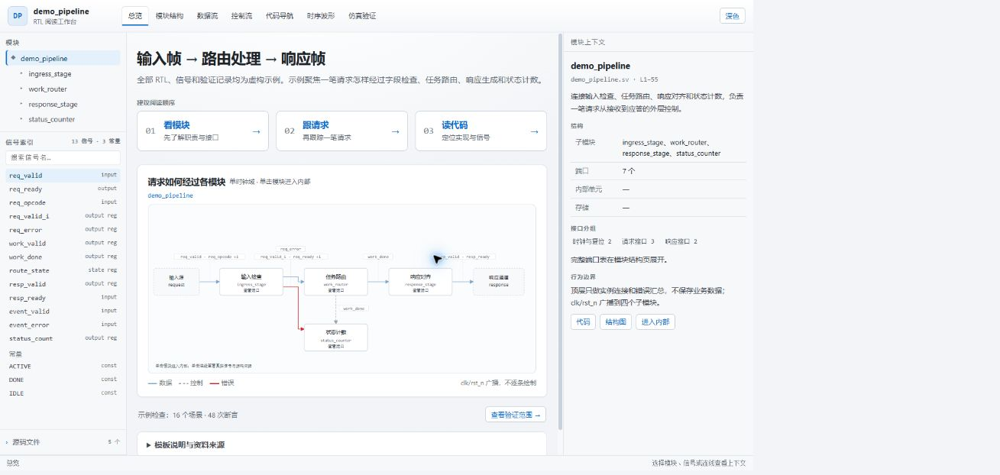
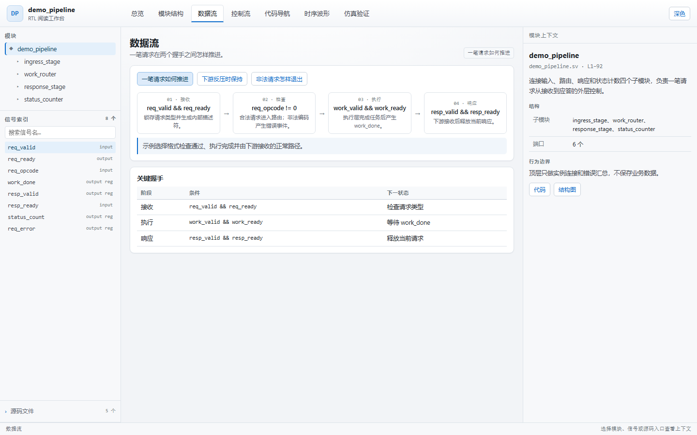
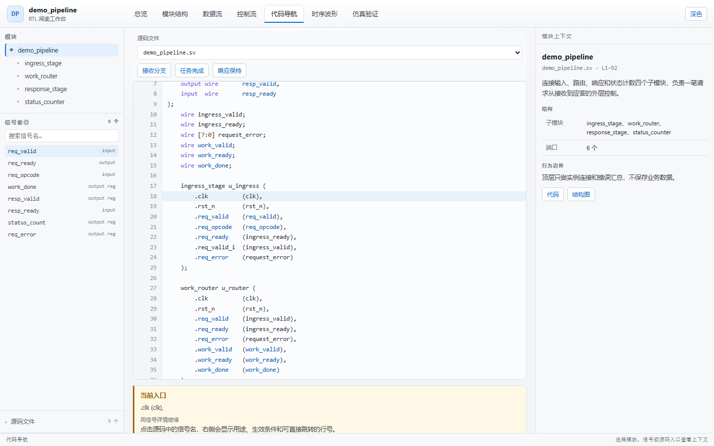
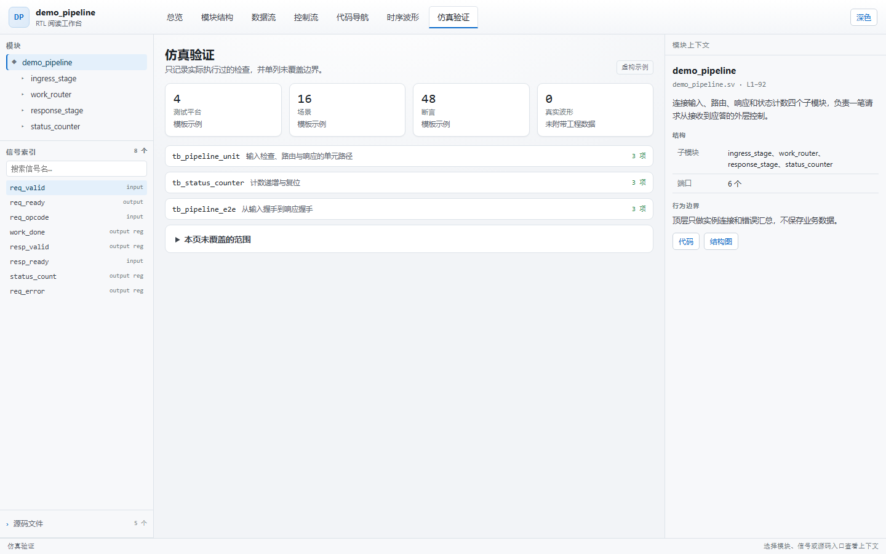

# RTL Reading Web

**代码写快了，读的人得有工具跟上。**

给 AI 编码助手一个技能：输入 Verilog / SystemVerilog / VHDL，输出一个可离线打开的中文阅读工作台。**模块层级、一笔事务、关键信号、源码行号**放在同一页上，读的人不用在编辑器、波形、文档和聊天窗口之间来回找。

它服务两类最常见的阅读：**AI 生成的 RTL**，和**别人写的 RTL**（交接、代码评审、第三方 IP）。



---

## 两类阅读，同一张工作台

### AI 写完的代码

生成一段 RTL 只要几分钟，把它读明白要的时间更长。模型记得住上下文，人记不住：某个标志为什么在这一拍清零，某个长度为什么卡在这个区间，答案都在代码里，只是散在几千行的不同位置。

工作台先把生成结果过一遍结构，让阅读从主路径而不是第 1 行开始：

- 一笔请求从进来到出去，分成几段，每段的触发条件是什么
- 信号点一下就有用途、生效条件、复位、更新和消费者
- 每条结论带文件名和行号，可以直接回源码核对
- 生成一次，之后回看都是本地打开一个静态网页

### 别人写的代码

交接、评审、接手第三方 IP 时，注释可能过期，文档可能缺失，能信的只有源码本身。工作台把阅读过程固定成可复核的路径：谁调用了这个信号，这个分支在什么条件下成立，这段代码影响哪些输出。

结论和证据绑定同一份源码快照（SHA-256 记录在 `source-manifest.json`），读到的行号对得上当前代码。生成的静态目录可以直接发给同事，让对方按同样的路径读一遍，省略口头讲解。

---

## 为什么做这个

读一份陌生的 RTL，通常要在四个窗口之间来回跳：

- 编辑器里 grep 信号
- 波形窗口里找握手
- 文档里翻架构
- 聊天窗口里问 AI

AI 给的总结经常有三个问题：**太散文、太自信、不可追溯**。

“这个模块负责数据通路的控制。”——等于没说。

“`route_active` 在请求握手时置位，在尾拍握手时清零。”——这才叫解释。

RTL Reading Web 换了一个交付物：**不是文档，是工作台**。

它把“读懂一个模块”拆成七件具体的事，每件事对应一个页签；关键结论都能落到真实文件、真实行号；没有波形就明确说没有，不拿示意图冒充实测。

---

## 它长什么样

### 1. 总览：先回答“这个模块做什么”

首屏只有一句任务说明、三个阅读入口、一张主结构图。没有统计卡墙，没有第二张同等级大图，也没有把侧栏信号复制一遍。


### 2. 数据流：跟踪一笔真实事务

从被接收到被处理、等待、完成或失败，每一步都给出条件和下一状态。不是把所有 `always` 块画成平行流程。



### 3. 代码导航：关键结论都能点回行号

信号、模块、关键条件都可以定位到真实源码。跳转后目录同步、目标行进入可视区并高亮，用户始终知道自己在哪里。



### 4. 仿真验证：没有报告就不生成通过率

没有报告就不生成通过率、覆盖率或“已验证”徽标。有报告时也标清数据源、日期、配置和适用范围。



> 以上截图来自内置的虚构示例 `demo_pipeline`，所有 RTL、信号和验证记录均为合成内容，不对应任何真实项目。

---

## 七个页签，各回答一个问题

| 页签 | 回答的问题 | 没有证据时 |
| --- | --- | --- |
| 总览 | 模块接收什么、完成什么、先读什么？ | 始终提供 |
| 模块结构 | 层级、实例、端口怎样连接？ | 始终提供 |
| 数据流 | 一笔请求何时被接受、等待、完成？ | 始终提供 |
| 控制流 | 状态、有效位、ready、优先级和错误出口怎样推进？ | 始终提供 |
| 代码导航 | 哪个文件、哪一行决定当前行为？ | 始终提供 |
| 时序波形 | 关键握手在哪些采样点成立？ | 无波形时省略或显示具体缺失原因 |
| 仿真验证 | 哪些场景真的执行过，哪些边界没覆盖？ | 无报告时省略或显示具体缺失原因 |

七个页签是一级导航，不会在正文里再造一套等权章节。

---

## 核心设计：把“不确定”当一等公民

### 三类结论，分开写

1. **源码事实**：能追溯到声明、表达式、分支、状态转换或实例连接。
2. **设计推导**：根据事实解释目的或影响；不把“为了优化时序”写成设计者意图。
3. **仿真观测**：只覆盖指定用例、配置和波形时刻。

页面不会把三者混成一段“看起来很确定”的话。

### 信号解释必须具体

不合格：

> `resp_valid` 是控制/状态标志，控制流程的启动、保持或结束。

合格：

> `resp_valid` 表示当前响应仍待下游接收；下游未接收时保持原值，与 `resp_ready` 同时为 1 才完成一次响应。

每个重点信号至少要回答：**用途、生效时机、复位、更新、来源、影响**。

### 同一事实只有一个主要位置

- 左栏负责定位：模块树、全量信号搜索、源码文件。
- 中央负责当前阅读页。
- 右栏负责当前对象的上下文。
- 来源和验证边界放在可展开的位置，不打断主阅读路径。

这样不会出现“左栏讲一遍、中央再讲一遍、右栏又讲一遍”的信号卡墙。

### 没有数据就不编

- 没有 VCD/波形：不画“实测”时序。
- 没有验证报告：不写通过率、覆盖率、用例数。
- 宏、generate、黑盒或缺失 include 无法解析：明确列出边界，不假装完整。
- 旧网页和旧报告：不能自动证明当前源码快照。

---

## 快速开始

### 方式一：项目级安装（推荐）

```bash
git clone https://github.com/AGouzi/rtl-reading-web.git
mkdir -p .agents/skills
cp -r rtl-reading-web .agents/skills/
```

Windows PowerShell：

```powershell
git clone https://github.com/AGouzi/rtl-reading-web.git
New-Item -ItemType Directory -Force .agents\skills | Out-Null
Copy-Item -Recurse .\rtl-reading-web .agents\skills\
```

### 方式二：安装到个人技能目录

```bash
cp -r rtl-reading-web ~/.codex/skills/
```

Windows PowerShell：

```powershell
Copy-Item -Recurse .\rtl-reading-web "$HOME\.codex\skills\"
```

只要宿主能读取 Markdown 技能并保留相对路径，也可以直接把整个目录放进它支持的技能目录。`SKILL.md` 必须在第一层，`agents/`、`references/`、`assets/` 一起保留。

### 调用

```text
使用 $rtl-reading-web。
源码：rtl/
顶层与配置：top，DATA_WIDTH=32
输出：doc/rtl-reading-web/
重点：让我看懂一笔写请求如何穿过模块，以及反压时哪些状态保持。
参考风格：使用技能内置的离线参考网页
波形/验证报告：无
```

生成后直接打开 `doc/rtl-reading-web/index.html`。参考实现是原生 HTML/CSS/JavaScript，不需要包管理器、EDA 工具、API 密钥或本地服务器。

---

## 它会交付什么

典型输出是一个自包含的静态目录：

```text
doc/rtl-reading-web/
├── index.html
├── style.css
├── data.js
├── app.js
└── source-manifest.json
```

`source-manifest.json` 记录顶层、参数/宏配置、文件逻辑路径、SHA-256 和生成时间。页面里的源码、行号、层级、端口映射和信号说明都绑定同一份快照；源码更新后需要重新核对，而不是只替换文字。

---

## 适合谁

- 要接手、维护 AI 生成的大段 RTL，需要尽快读懂的人
- 接手陌生模块、同事交接代码或第三方 IP 的 FPGA / ASIC 工程师
- 需要给同事、评审或新人做代码讲解的人
- 想把阅读结果沉淀成可离线分享材料的团队

## 不适合谁

- 想让工具替代仿真、CDC 检查、时序签核或形式验证的人
- 只需要一段代码解释、不需要页面和追溯关系的人
- 希望自动修改 RTL 的人（本技能不授权改源码）
- 没有任何源码、只想生成一个漂亮演示页的人

---

## 兼容性与边界

- 面向支持 Markdown 技能、文件读写和代码生成的 AI 宿主；在 Codex 类宿主中开发和验证。
- 生成物是静态网页，可离线打开；不引入后端、云服务、CDN 或在线大模型接口。
- 需要浏览器验证能力时按环境使用；缺失时如实报告未验证项。
- 不能仅凭阅读代码得出 CDC、时序或硬件结论。
- 大型设计需要明确顶层和阅读范围；技能会覆盖主路径、分支和用户指定对象，不承诺“全库语义证明”。
- VHDL、SystemVerilog 的宏/配置/generate 边界按实际可解析程度标注。

---

## 隐私与安全

- 生成的页面不发起网络请求，不上传源码，不包含遥测。
- 参考页只使用相对路径引用包内资源，字体使用系统回退。
- 主题选择只写入浏览器 `localStorage`。
- 仓库内的示例工程、信号、验证记录均为虚构内容。

发布或转发前建议按 [`references/portability.md`](references/portability.md) 的脱敏规则复查：真实项目名、客户名、型号、内部路径、主机名、账号、密钥、仓库地址和专有协议字段都不应进入分享包。

本仓库的审计记录见 [`docs/security-audit.md`](docs/security-audit.md)。

---

## 仓库结构

```text
rtl-reading-web/
├── SKILL.md                     # 技能入口与硬约束
├── agents/openai.yaml           # 宿主展示信息
├── references/
│   ├── rtl-evidence.md          # 语义与证据分级
│   ├── reading-design.md        # 页面与信息设计
│   ├── acceptance.md            # 验收标准
│   └── portability.md           # 迁移、分享与脱敏
├── assets/reference-reader/     # 可离线打开的参考工作台
├── docs/
│   ├── wechat-article.md        # 公众号推文
│   ├── wechat-publish-notes.md  # 配图与排版备注
│   ├── security-audit.md        # 发布前审计
│   └── screenshots/             # 虚构示例截图
└── README.md
```

---

## 常见问题

**它和“让 AI 写一份 RTL 设计文档”有什么区别？**

文档是线性的，工作台是按问题组织的。读 RTL 时你通常先问“它做什么”，再问“这笔请求怎么走”，最后才问“哪一行决定的”。七个页签对应这条阅读路径，而不是章节顺序。

**没有波形和验证报告，页面还有用吗？**

有用。代码阅读、模块结构、数据流、控制流和源码定位都不依赖仿真。技能会明确标注“本次未运行仿真”，不会用示意图补齐。

**会不会把旧结论带到新代码上？**

技能要求先核对源码快照，再决定哪些内容可复用。旧网页只能作为布局参考，不能连同旧行号、旧统计一起复制。

**能不能直接双击打开？**

可以。参考实现没有 `fetch`、ES module 或后端依赖，`file://` 可打开。若你的生成页面引入了需要 HTTP 的功能，交付说明必须给出启动命令，不能宣称双击完整可用。

**支持哪些语言？**

Verilog、SystemVerilog 和 VHDL。具体解析深度取决于源码中的宏、generate、黑盒和缺失依赖；无法解析的部分会被标成边界。

---

## English

RTL Reading Web is an agent skill that turns Verilog, SystemVerilog, or VHDL sources into a traceable, offline Chinese reading workbench.

It targets two common cases: reading RTL that an AI just generated, and reading RTL written by someone else — inherited modules, review targets, or third-party IP.

Instead of a long, confident-sounding summary, it generates a seven-tab static site:

- Overview
- Module hierarchy
- Data flow
- Control flow
- Code navigation
- Timing / waveform
- Simulation evidence

Every important claim links back to a real file and line. Signals are explained by purpose, update condition, reset behavior, sources, and consumers. When waveform or verification data is missing, the page says so instead of fabricating evidence.

The output is plain HTML/CSS/JavaScript with no backend, CDN, API key, or build step.

```bash
git clone https://github.com/AGouzi/rtl-reading-web.git
mkdir -p .agents/skills
cp -r rtl-reading-web .agents/skills/
```

Then ask your agent:

```text
Use $rtl-reading-web.
Source: rtl/
Top: top, DATA_WIDTH=32
Output: doc/rtl-reading-web/
Focus: trace one write request end to end, including backpressure.
```

---

## License

[MIT](LICENSE)

示例工程与截图均为虚构内容，仅用于展示阅读工作台的结构和交互。
