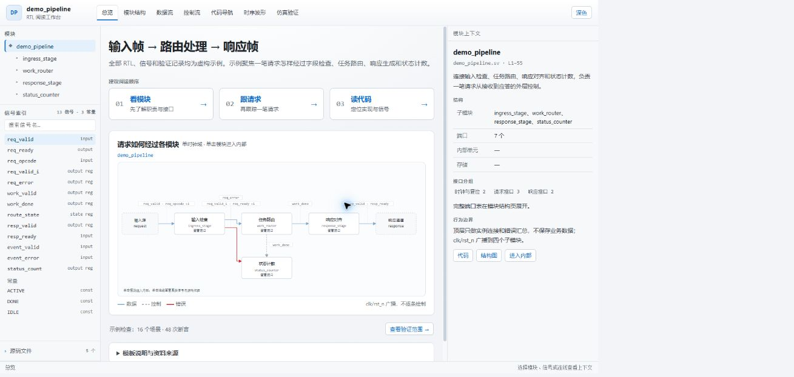
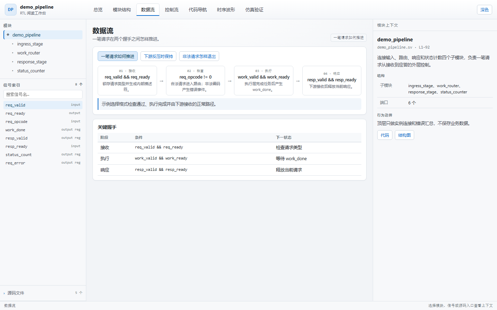
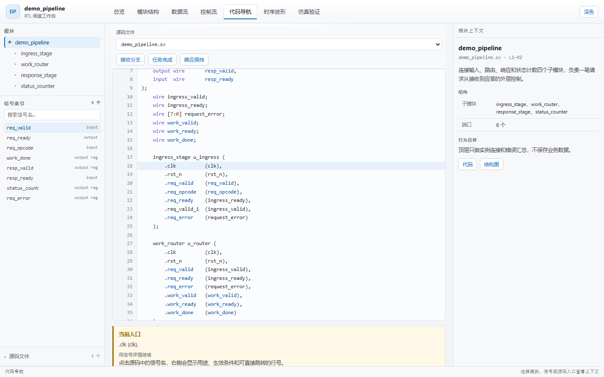

# 读 RTL 慢，不是因为你不懂 Verilog

> 副标题：我给 AI 做了个阅读工作台：7 个页签，每个结论都能点回源码
>
> 备选标题：
> 1. 别再让大模型“总结” RTL 了
> 2. 我把读 RTL 这件事，做成了一个能点的网页
> 3. 读懂别人的 Verilog，到底难在哪

---

周一早上，你接手一个模块。

顶层文件几百行，下面挂了好几个子模块。你知道它大概在做什么，但不知道从哪看起。

你搜 `req_ready`，编辑器给出 47 个结果。你打开波形，盯着 `valid/ready` 看了十分钟，还是不确定这个握手到底发生在哪一拍。

你问 AI。它回你：

> 该模块负责请求调度、数据处理与响应生成，通过 valid/ready 握手保证传输正确。

你关掉对话框。

不是它说错了。是它什么都没说。

---

## 读 RTL 的真正成本，是“重建现场”

语法不是门槛。写过两个项目的人，都能看懂 `always @(posedge clk)`。

真正耗时的是重建现场：

- 这个模块接收什么，交给谁？
- 一笔请求从哪里进来，在哪里被拦住？
- `ready` 拉低时，哪些状态保持，哪些状态还在更新？
- 这个结论到底来自代码，还是来自文档，还是来自我的猜测？

这些问题，grep 回答不了，波形回答一半，文档经常过期。

而大模型的总结，通常是线性的：从模块职责讲到端口，再讲到状态机，最后给你一段“设计严谨、逻辑清晰”的废话。

你读完还是不知道下一次该点哪里。

所以我想要的东西很具体：

**不是一份更长的总结，而是一个能让我少点几次鼠标的工作台。**

---

## 它不是一个文档，是七个页签

我把这套阅读路径固化成了一个技能：`rtl-reading-web`。

输入 Verilog / SystemVerilog / VHDL，输出一个可离线打开的中文网页。

首页长这样：



左边是模块树、全量信号搜索、源码文件；中间是当前阅读页；右边是当前对象的上下文；底部是状态栏。

没有仪表盘，没有统计卡墙，没有“欢迎使用 RTL 阅读系统”。

首屏只有三样东西：**一句任务说明、三个阅读入口、一张主结构图**。

这三个入口不是装饰：

1. 看模块：先知道职责和接口。
2. 跟请求：再跟踪一笔真实事务。
3. 读代码：最后落到文件和行号。

阅读顺序和人的提问顺序一致。

---

## 01 先看总览：它到底在做什么

总览页只回答一个问题：这个模块接收什么、完成什么、输出什么。

不是“这是一个功能强大、设计完善的模块”。

而是“连接输入、路由、响应和状态计数四个子模块，负责一笔请求从接收到应答的外层控制”。

一句话里得有具体对象、具体动作、具体边界。

主结构图也不是拿 PowerPoint 画的示意图。节点来自真实实例，连线来自端口映射，点节点能跳到对应模块。

---

## 02 再看数据流：一笔请求怎么走

数据流页是我用得最多的。

它不把所有 `always` 块画成平行流程，而是选一条真实事务，从入口跟到出口：



每一步给出四件事：

- 触发条件
- 执行动作
- 等待条件
- 下一步

比如“接收”这一步，条件不是“请求有效”，而是 `req_valid && req_ready`。

只有 valid 没有 ready，不叫一次传输。这个区别，很多总结会含糊过去。

有反压时，页面会单独给出保持路径：`resp_valid && !resp_ready` 时哪些值不变，恢复后哪一拍释放。

这比“支持反压”四个字有用得多。

---

## 03 最后看代码：点一下，落到行

重要的模块、信号和关键条件都能跳源码。

跳转之后，目录同步、目标行进入可视区、高亮当前入口：



不是给你一个“查看源码”按钮，点完打开一个新标签页，然后你忘了自己刚才在看哪个信号。

同名信号会带模块或实例路径。`req_valid` 在顶层、输入级和路由级可能不是一个东西，页面不会默默选第一个。

---

## 它最“反 AI”的地方：不编

这是我做这个技能时最在意的部分。

大模型最危险的不是不会，而是**不会的时候也很自信**。

所以页面把结论分成三类：

1. **源码事实**：能追到声明、表达式、分支、状态转换或实例连接。
2. **设计推导**：根据事实解释目的或影响，但不冒充设计者意图。
3. **仿真观测**：只覆盖指定用例、配置和波形时刻。

三类不能混着写。

没有 VCD，就不画“实测波形”。

没有验证报告，就不写通过率、覆盖率、用例数。

宏、generate、黑盒、缺失 include 解析不了，就明确列出边界，不假装完整。

信号解释也必须具体。

不合格：

> `route_active` 是控制/状态标志，控制流程的启动、保持或结束。

合格：

> `route_active` 标记已接受请求的载荷路由仍在占用；为 0 时阻止载荷被继续接收。请求握手置位，尾拍握手清零。

后者你读完能预测行为，前者你读完只能点头。

---

## 为什么是网页，不是一份 Markdown

因为读 RTL 不是线性阅读。

你会在一张图、一个信号、一段代码、一个状态机之间来回跳。Markdown 适合讲一个故事，不适合承载这种定位关系。

网页能做的事：

- 左栏常驻全量信号索引，搜索不用离开当前页
- 中央只放当前问题，不把所有内容堆成一条长滚动
- 右栏跟着当前选择走，不重复中央全文
- 图节点、信号、代码行共享同一套选中状态
- 窄屏自动把左右栏收成抽屉，主阅读顺序不变

但它也不是“功能越多越好”。

页面有明确的信息预算：

- 七个页签是唯一的一级导航，正文不再造一套章节
- 总览只放 3 个阅读入口、1 张主图
- 左栏已有全量信号，中央不再生成同样的信号卡墙
- 统计只放在验证页，而且必须来自真实报告
- 没有内容的页签省略，或者显示具体缺失原因

这年头，克制比堆功能难。

---

## 怎么用

项目地址：

**https://github.com/AGouzi/rtl-reading-web**

安装：

```bash
git clone https://github.com/AGouzi/rtl-reading-web.git
mkdir -p .agents/skills
cp -r rtl-reading-web .agents/skills/
```

Windows PowerShell：

```powershell
git clone https://github.com/AGouzi/rtl-reading-web.git
New-Item -ItemType Directory -Force .agents\skills | Out-Null
Copy-Item -Recurse .\rtl-reading-web .agents\skills\
```

然后给 AI 一段这样的指令：

```text
使用 $rtl-reading-web。
源码：rtl/
顶层与配置：top，DATA_WIDTH=32
输出：doc/rtl-reading-web/
重点：让我看懂一笔写请求如何穿过模块，以及反压时哪些状态保持。
波形/验证报告：无
```

生成后直接打开 `doc/rtl-reading-web/index.html`。

没有 npm install，没有后端，没有 API Key，没有 CDN。整个目录拷走就能离线看。

---

## 它适合谁，不适合谁

适合：

- 接手陌生 RTL，需要先建立全貌的人
- 要给同事、评审或新人讲代码的人
- 想让 AI 帮忙读代码，但不想接受“无依据总结”的团队
- 需要把阅读结果沉淀成可离线分享材料的人

不适合：

- 想让工具替代仿真、CDC 检查、时序签核的人
- 只需要解释一段代码、不需要页面和追溯关系的人
- 希望 AI 顺手改 RTL 的人

---

## 说点实话

它不是“一键读懂所有 RTL”。

它不能替代仿真，不能替代时序分析，不能替代你对协议和业务的理解。

遇到宏、generate、黑盒或缺失依赖，它只能标出边界，不能凭空补全。

大设计也必须先划范围。你给它一个顶层，它能围绕主路径展开；你给它一整个仓库，它也会迷路。

但至少，它不会假装自己什么都懂。

---

读 RTL 这件事，短期内还是得靠人。

工具能做的，是把“找”的时间压下去，把“想”的时间留出来。

如果你也经常在别人的 Verilog 里迷路，欢迎试试。

项目地址：

**https://github.com/AGouzi/rtl-reading-web**

如果它对你有用，给个 star；如果身边有同样在读 RTL 的同事，转给他。

少熬一个晚上，也算功德一件。
